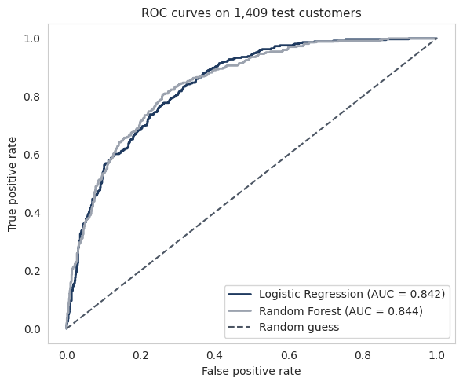
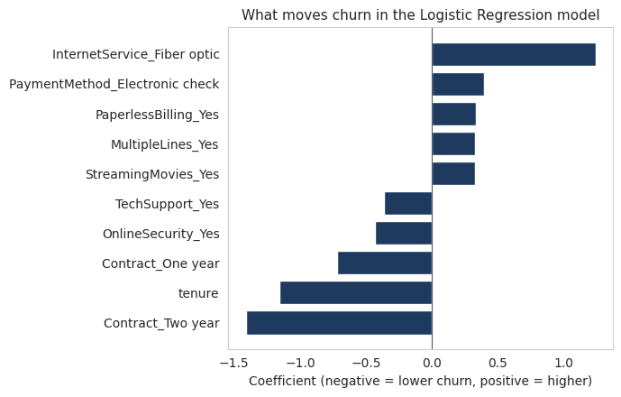

# Customer Churn Prediction

A customer retention team uses the model to flag customers likely to cancel, so they can contact those customers first before they leave.

Data: the public IBM Telco customer churn sample (7,043 customers, 21 columns).

## Results on 1,409 held-out test customers

| Model | Accuracy | Recall | Precision | ROC-AUC |
|---|---|---|---|---|
| Logistic Regression | 74.0% | 78.6% | 50.6% | 0.842 |
| Random Forest | 76.1% | 77.8% | 53.4% | 0.844 |
| Always predict "no churn" | 73.5% | 0% | n/a | n/a |

Accuracy hides missed churners. A model that always says "no churn" scores 73.5% and catches none. Logistic Regression catches 294 of the 374 customers who left.

I recommend Logistic Regression because its coefficients are easy to read and its recall is as good as Random Forest's.

## Data cleaning

TotalCharges was the only column with missing values: 11 blanks stored as text. All 11 customers had tenure 0, so I converted the column to numbers and filled the blanks with 0, keeping all 7,043 customers.

## Method

80/20 stratified split, class weights, scaling inside a Pipeline, and 5-fold cross-validation on the training set only. The test set was used once.

## Limits

- About half of the customers the model flags stay (287 of 581), so contacting them has a cost.
- I assume a missed churner costs more than a wasted contact. I have not tested that.
- I have not tested whether contacting flagged customers keeps them.
- The 0.5 decision threshold and the model settings were not tuned.
- Results come from a single 80/20 split, so numbers could shift a little with another split.

## Files

- `customer_churn_prediction_.ipynb`: the full notebook
- `telco.csv`: the dataset
- `requirements.txt`: the Python packages to install

## Run it

    pip install -r requirements.txt

Then open the notebook in Jupyter or Google Colab and run all cells.
